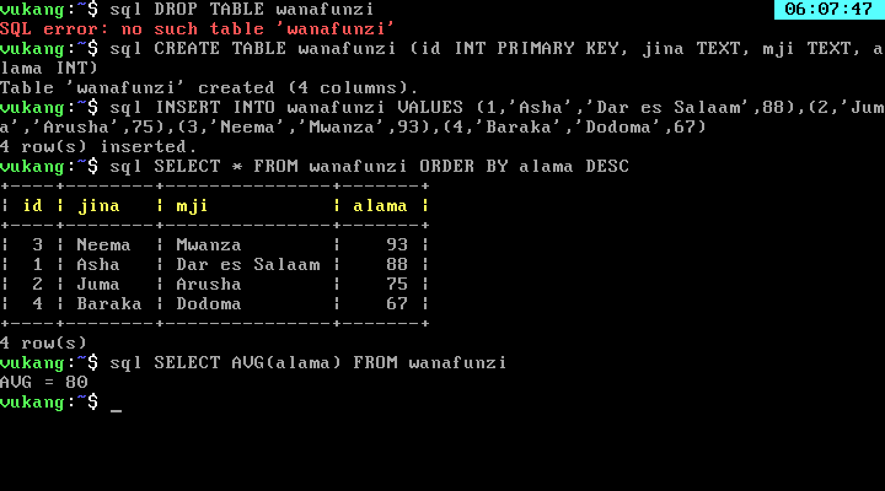

# VUKANG OS

**Mfumo wa uendeshaji (Operating System) halisi, uliojengwa kuanzia sifuri kwa C na Assembly, wenye database (SQL) iliyojengwa ndani yake.**
Imetengenezwa Tanzania na VukangTech.


VUKANG OS haitumii Linux, Windows wala maktaba (library) yoyote ya nje. Kila kitu ni chetu: bootloader entry, kernel, memory manager, scheduler, drivers, filesystem, database engine na shell. Inawaka kwenye kompyuta halisi ya x86 au kwenye emulator (QEMU, VirtualBox).

## Kuna nini ndani

| Sehemu | Maelezo |
|---|---|
| Kernel | Monolithic, 32-bit protected mode, inawaka kupitia GRUB (Multiboot) |
| CPU | GDT, TSS, IDT, exceptions 32, IRQ 16, PIC remap |
| Memory | Physical frame allocator (bitmap), paging ya ngazi 2, kernel heap ya 8 MiB (`kmalloc`/`kfree`) |
| Multitasking | Preemptive round-robin scheduler kwa 100 Hz, `ps`, `spawn`, `kill`, `sleep` |
| User mode | Programu za ring 3, system calls kupitia `int 0x80`, ulinzi wa kumbukumbu (memory protection) |
| Drivers | VGA text, PS/2 keyboard, serial COM1, PIT timer, CMOS RTC (saa), ATA hard disk, PC speaker, reboot/shutdown |
| Filesystem | **VKFS**, filesystem yetu wenyewe kwenye hard disk au RAM disk |
| Database | **VukangDB**, SQL engine ndani ya OS: tables, PRIMARY KEY, WHERE, ORDER BY, LIMIT, COUNT/SUM/AVG/MIN/MAX, UPDATE, DELETE, transactions (BEGIN/COMMIT/ROLLBACK), data inabaki baada ya kuzima |
| Shell | **VKSH**: amri 25, pamoja na `demo` maalum kwa presentation |

## Kuijenga na kuiendesha

Kwenye Ubuntu/Debian (au WSL kwenye Windows):

```bash
sudo apt install build-essential nasm qemu-system-x86 grub-pc-bin grub-common xorriso mtools
git clone https://github.com/vukangtech-cmyk/vukang-os.git
cd vukang-os
make run          # inafungua dirisha la QEMU
make run-serial   # bila dirisha, shell ndani ya terminal (toka: Ctrl+A kisha X)
make test         # majaribio ya kiotomatiki (16 checks)
```

Faili `build/vukang-os.iso` linaweza kuwashwa kwenye VirtualBox, au kuandikwa kwenye USB na kuwashwa kwenye kompyuta halisi yenye BIOS/Legacy boot.

## Jaribu hivi

```
vukang:~$ demo
vukang:~$ sql CREATE TABLE wanafunzi (id INT PRIMARY KEY, jina TEXT, alama INT)
vukang:~$ sql INSERT INTO wanafunzi VALUES (1,'Asha',88),(2,'Juma',75)
vukang:~$ sql SELECT * FROM wanafunzi ORDER BY alama DESC
vukang:~$ db            # SQL console kamili
vukang:~$ spawn 3       # tasks 3 zinakimbia pamoja
vukang:~$ usermode      # programu ya ring 3 inajaribu kuvunja sheria, kernel inaishinda
```



## Muundo wa mradi

```
boot/        Multiboot entry (assembly)
kernel/      kmain, arch/ (GDT, IDT, ISR, timer, usermode), mm/ (pmm, paging, heap), proc/ (tasks, syscalls)
drivers/     vga, serial, keyboard, rtc, ata, power
fs/          blockdev + VKFS
db/          VukangDB: lexer, storage engine, SQL engine
shell/       VKSH shell
lib/         string + kprintf
include/     headers
docs/        nyaraka (Kiswahili)
scripts/     majaribio ya kiotomatiki
```

## Nyaraka

- [Usanifu (Architecture)](docs/ARCHITECTURE.md): jinsi kila sehemu inavyofanya kazi
- [Mwongozo wa Presentation](docs/PRESENTATION.md): slides, demo script na maswali ya majaji
- [Maintenance](docs/MAINTENANCE.md): jinsi tunavyoendeleza mradi
- [Roadmap](docs/ROADMAP.md): matoleo yajayo
- [CHANGELOG](CHANGELOG.md)

## Leseni

MIT. Angalia [LICENSE](LICENSE).
