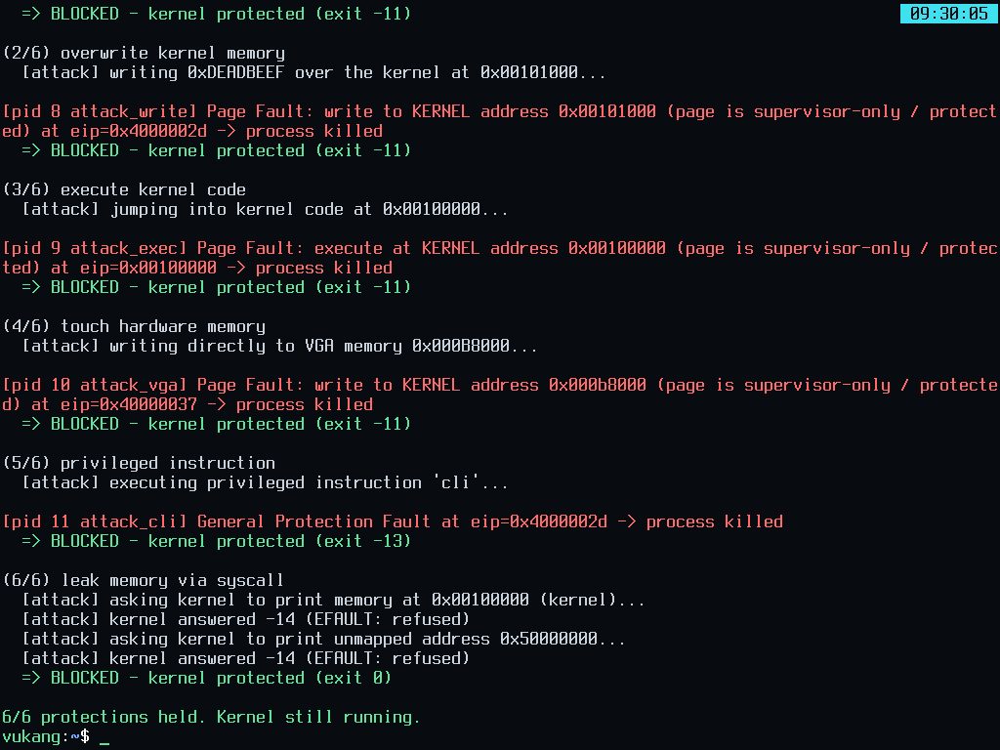

# Usalama wa VUKANG OS (v0.2.0 "Serengeti")

Hati hii inaeleza matatizo manne ya usalama yaliyogunduliwa kwenye v0.1.0 "Kilimanjaro", jinsi v0.2.0 ilivyoyatatua, na jinsi ya kuthibitisha kila suluhisho kwa macho yako mwenyewe. Mwishoni kuna orodha ya makosa mengine tuliyoyagundua wakati wa ukaguzi.

Kila suluhisho lina njia tatu za kuthibitisha:

- **`security`**: amri ya shell inayoendesha programu 6 za ring 3 zinazojaribu kushambulia kernel. Zote lazima zizuiwe ("6/6 protections held").
- **`selftest`**: majaribio 23 yanayokimbia ndani ya kernel yenyewe dhidi ya PMM, heap na paging ("23 passed, 0 failed").
- **`make test`**: majaribio 30 ya kiotomatiki yanayowasha OS ndani ya QEMU (pia yanaendeshwa na GitHub Actions kwa kila PR).

---

## Tatizo 1: `PG_USER` ilikuwa kwenye karibu kila ukurasa

### Tatizo
Kwenye v0.1 RAM yote iliwekwa identity map ikiwa na bit ya `PG_USER`. CPU ilizuia amri za hatari kama `cli` kutoka ring 3, lakini programu ya ring 3 bado ingeweza **kusoma na kuandika kumbukumbu ya kernel**, kwa mfano kubadilisha page tables au heap. Kuzuia `cli` peke yake hakutoshi.

### Suluhisho (`kernel/mm/paging.c`, `kernel/proc/`)
1. **Kurasa zote za kernel ni supervisor-only.** Identity map ya kernel (0 hadi `kernel_limit`) haina `PG_USER` hata kidogo. Ring 3 ikigusa anwani yoyote ya kernel, CPU inatoa Page Fault.
2. **Address space tofauti kwa kila process.** Kila process inapata page directory yake (`vmm_create_space`). PDE za kernel zinashirikiwa (supervisor-only) ili kernel ifanye kazi baada ya kubadilisha CR3, lakini sehemu ya user `0x40000000 - 0x80000000` ni ya process hiyo peke yake.
3. **`PG_USER` inaruhusiwa tu ndani ya user range.** `vmm_map` inakataa kuweka `PG_USER` kwenye anwani iliyo nje ya `USER_BASE..USER_END`.
4. **CR0.WP imewashwa.** Hata kernel inaheshimu kurasa za read-only.
5. **Stack ya user ina guard page.** `USER_STACK_TOP = 0x7FFFF000` na ukurasa ulio juu yake haujawekwa, hivyo stack overflow inakamatwa.
6. **Scheduler inabadilisha CR3 na `TSS.esp0`** kwa kila task, na process ikifa frames zake zote (data, stack, page tables, page directory) zinarudishwa kwa PMM.
7. **Syscalls hazimwamini mtumiaji.** `SYS_WRITE` inakagua kwamba string yote iko ndani ya user space na imewekwa (`vmm_user_range_ok`, `vmm_user_strlen`) bila integer overflow. Pointer ya kernel au isiyowekwa inarudisha `-EFAULT` (-14) badala ya kuvuja data.
8. **Kosa la user haliui kernel.** Page Fault au GPF kutoka ring 3 inaua process hiyo tu, na ujumbe unaeleza kosa: read/write/execute, anwani ya KERNEL au user, na kama ukurasa ni supervisor-only au haujawekwa.

### Thibitisha
`security` inaendesha mashambulizi haya:

| # | Programu | Shambulizi | Matokeo |
|---|---|---|---|
| 1 | `attack_read` | kusoma kernel kwenye `0x00100000` | Page Fault, exit -11 |
| 2 | `attack_write` | kuandika `0xDEADBEEF` juu ya kernel | Page Fault, exit -11 |
| 3 | `attack_exec` | kuruka ndani ya code ya kernel | Page Fault (execute), exit -11 |
| 4 | `attack_vga` | kuandika moja kwa moja kwenye VGA `0xB8000` | Page Fault, exit -11 |
| 5 | `attack_cli` | amri ya `cli` | General Protection Fault, exit -13 |
| 6 | `attack_syscall` | kuomba kernel ichapishe kumbukumbu ya kernel/isiyowekwa | kernel inajibu -14 (EFAULT) |

`selftest`: "kernel pages are supervisor-only", "NULL page unmapped", "refuse PG_USER on kernel range", "map user page in private space", "user page invisible to kernel dir", "destroying space frees its frames".

Tangu v0.2.1 framebuffer ya graphics nayo imewekwa kama kurasa za supervisor-only (`FB_VIRT = 0xC0000000`), kwa hiyo programu ya ring 3 haiwezi kuchora juu ya skrini wala kusoma kilichopo.

---

## Tatizo 2: `pmm_free` haikukagua chochote

### Tatizo
`pmm_free(addr)` haikukagua alignment ya 4096, haikukagua kama frame iko ndani ya RAM, ingeweza kuachia frame ya kernel au BIOS, na double free ingeharibu hesabu ya frames huru.

### Suluhisho (`kernel/mm/pmm.c`)
- **Bitmap mbili:** `used[]` (frame inatumika) na `locked[]` (frame haiwezi kuachiliwa kamwe).
- **Frames zilizofungwa (locked) wakati wa kuwaka:** eneo la BIOS chini ya 1 MiB, kernel image (`kernel_start..kernel_end`), muundo wa multiboot, ramani ya kumbukumbu (mmap), command line, modules za GRUB, page directory na page tables za kernel, na heap nzima.
- **`pmm_free` sasa inarudisha status** na haigusi hesabu hadi ukaguzi wote upite:

| Ukaguzi | Status |
|---|---|
| `addr` si kizidisho cha 4096 | `PMM_ERR_UNALIGNED` |
| frame iko nje ya RAM inayosimamiwa | `PMM_ERR_RANGE` |
| frame imefungwa (kernel/BIOS/boot data/page tables/heap) | `PMM_ERR_LOCKED` |
| frame tayari iko huru | `PMM_ERR_DOUBLE_FREE` |

- Ramani ya GRUB inasomwa kwa namba za 64-bit (hakuna overflow juu ya 4 GiB) na imewekewa kikomo cha 1 GiB (`MAX_MEM`), ambacho hakigusi user space.
- OS inakataa kuwaka (panic yenye ujumbe wazi) kama RAM ni chini ya 16 MiB.
- Kila free iliyokataliwa inahesabiwa na inaonekana kwenye `mem` ("Rejected: N bad frame frees").

### Thibitisha
`selftest` sehemu ya "Physical memory manager": reject double free, reject unaligned address, reject frame outside RAM, reject freeing kernel image, reject freeing BIOS area, reject freeing page directory, reject freeing heap frames, accounting unchanged.
`make test` pia inaendesha processes 11 kisha inakagua kwamba idadi ya frames huru imerudi pale pale (hakuna leak).

---

## Tatizo 3: `kmalloc`/`kfree` zingeweza kudanganywa

### Tatizo
`n + 15` ingeweza ku-overflow kwa `n` kubwa sana, ikarudisha block ndogo kuliko iliyoombwa. `kfree` ilisoma header ya block kabla ya kujua kama pointer ni halali.

### Suluhisho (`kernel/mm/heap.c`)
- **Ukaguzi wa ukubwa kwanza:** `n == 0` au `n` kubwa kuliko heap nzima inarudisha `NULL` kabla ya hesabu yoyote ya padding. Hivyo overflow haiwezekani.
- **Header ya bytes 16:** `{magic, size, req, next}` yenye magic mbili, `VKHU` (inatumika) na `VKHF` (huru). Payload ina alignment ya 16.
- **Canary `0xC0FFEE42`** inawekwa mara baada ya bytes zilizoombwa. `kfree` ikiona canary imeharibika, ni buffer overflow, na kernel inasimama (panic) badala ya kuendelea na heap iliyoharibika.
- **`kfree` inakagua pointer KABLA ya kusoma header:** iko ndani ya `heap_start..heap_end`, ina alignment sahihi, na ni mwanzo halisi wa block (inatafutwa kwenye orodha ya blocks). Pointer ya kigeni, ya katikati ya block, au double free inaandikwa kwenye log na kukataliwa.
- **Poison `0xDD`:** kumbukumbu iliyoachiliwa inajazwa `0xDD` ili use-after-free ionekane haraka.
- `krealloc` inapitia ukaguzi huo huo, na `heap_check()` inapitia heap nzima kuthibitisha magic na canaries (inaonekana kwenye `mem` kama "integrity ok").

### Thibitisha
`selftest` sehemu ya "Kernel heap": reject huge size (overflow), reject size larger than heap, allocate + 16-byte alignment, reject foreign/interior pointers, reject double free, freed memory poisoned (0xDD), heap integrity check.

---

## Tatizo 4: mpangilio wa `pmm_init`, `heap_init`, `paging_init`

### Tatizo
Heap iliwekwa kwenye anwani isiyobadilika bila kuhakikisha kwamba iko ndani ya RAM iliyopo, imewekwa kwenye page tables, haigongani na page tables, na haifuniki kernel au data ya boot.

### Suluhisho (`kernel/kmain.c`, `kernel/mm/heap.c`)
Mpangilio mpya ni **`pmm_init` → `paging_init` → `heap_init`**:

1. `pmm_init` inajua RAM halisi na inafunga kernel, BIOS na boot data.
2. `paging_init` inaweka ramani ya kernel inayofunika RAM yote inayosimamiwa (`paging_kernel_limit`), na frames za page directory/tables zinatoka PMM na **zinafungwa** ili allocator mwingine asizitumie tena.
3. `heap_init` inaomba eneo **linalofuatana (contiguous)** kutoka PMM kupitia `pmm_alloc_contiguous(pages, kernel_end, locked=true)`. Inaanza na 8 MiB na kupunguza nusu hadi 1 MiB kama RAM ni ndogo. Kisha inathibitisha:
   - eneo liko juu ya `kernel_end` (halifuniki kernel image),
   - eneo lote liko chini ya `paging_kernel_limit()` (limewekwa kwenye page tables),
   - frames zote zimefungwa (hazitolewi tena na PMM, na `pmm_free` inazikataa).

   Ukaguzi wowote ukishindwa, kernel inasimama na ujumbe wazi badala ya kuendelea vibaya.

### Thibitisha
Mstari wa boot unaonyesha: `heap 8 MiB at 0x...-0x... (locked, inside map)`. Tumejaribu RAM tofauti:

| RAM ya QEMU | Matokeo |
|---|---|
| 15 MiB, 16 MiB | Panic: "needs at least 16 MiB of RAM" (kwa makusudi; BIOS inachukua sehemu, hivyo RAM inayoonekana ni chini ya 16 MiB) |
| 24 MiB | heap 8 MiB, selftest 23/23, security 6/6 |
| 64 MiB, 512 MiB | heap 8 MiB, selftest 23/23, security 6/6 |
| 1 GiB, 2 GiB | ramani imewekewa kikomo cha 1 GiB, selftest 23/23, security 6/6 |

---

## Makosa mengine yaliyogunduliwa na kurekebishwa

| Sehemu | Kosa | Suluhisho |
|---|---|---|
| VKFS mount | Superblock iliyoharibika au ya uongo ingeweza kufanya kernel isome/iandike nje ya disk | Superblock inakaguliwa (geometry, ukubwa, mahali pa bitmap/directory). Volume mbaya inakataliwa |
| VKFS directory | Entry iliyoharibika (start/ukubwa nje ya disk, jina bila mwisho) | Kila entry inakaguliwa wakati wa mount, mbaya zinaondolewa ("removed N corrupted directory entries") |
| VKFS I/O | Makosa ya kusoma/kuandika disk yalipuuzwa | Kila operesheni inakagua matokeo na kurudisha kosa |
| ATA driver | LBA nje ya disk au juu ya kikomo cha LBA28 | Ukaguzi wa mipaka kabla ya kutuma amri |
| VukangDB | Schema ya table iliyoharibika ingeleta crash | Schema inathibitishwa inapopakiwa, rows zinahesabiwa upya, TEXT inamalizwa kwa `\0` |
| VukangDB | Kushindwa kukuza table hakukushughulikiwa | Kosa linarudishwa kwa mtumiaji |
| Shell/DB | `kmalloc` ikirudisha `NULL` (ls, cat, write, append, select, show tables) | Ukaguzi wa `NULL` kila mahali |
| Scheduler | Task zote zikilala, `sleep` haikufanya kazi sawasawa | Idle task inayofanya `hlt` |
| User mode | Programu za user ziliishi ndani ya kernel image (`usermode.asm`) | Programu ni faili za ELF halisi (`user/*.c`) zinazopakiwa na ELF loader yenye ukaguzi wa mipaka |

## Mipaka iliyobaki (kazi za matoleo yajayo)

- Programu za ELF bado zimewekwa ndani ya kernel image (`incbin`). Kuzipakia kutoka VKFS ni kazi ya v0.3.
- Hakuna `fork`/`exec` bado, na syscalls za faili hazipo kwa user.
- Hakuna ASLR, NX bit (inahitaji PAE) wala stack canaries za compiler.
- VukangDB bado haina journal (WAL) ya kulinda data umeme ukikatika.
